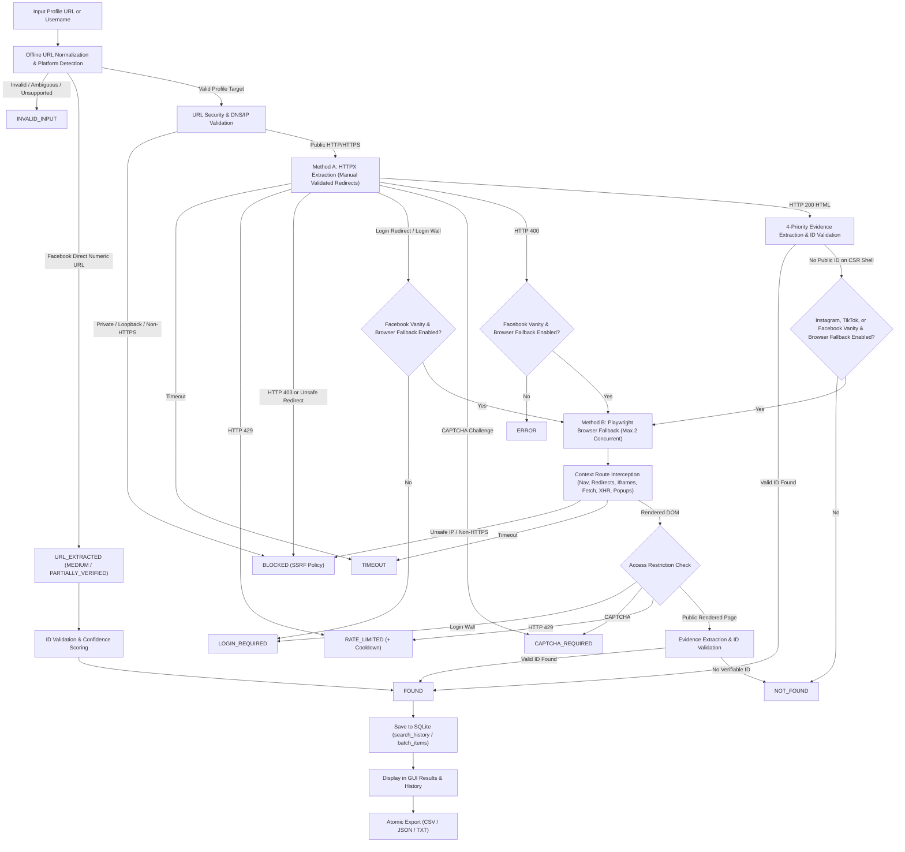
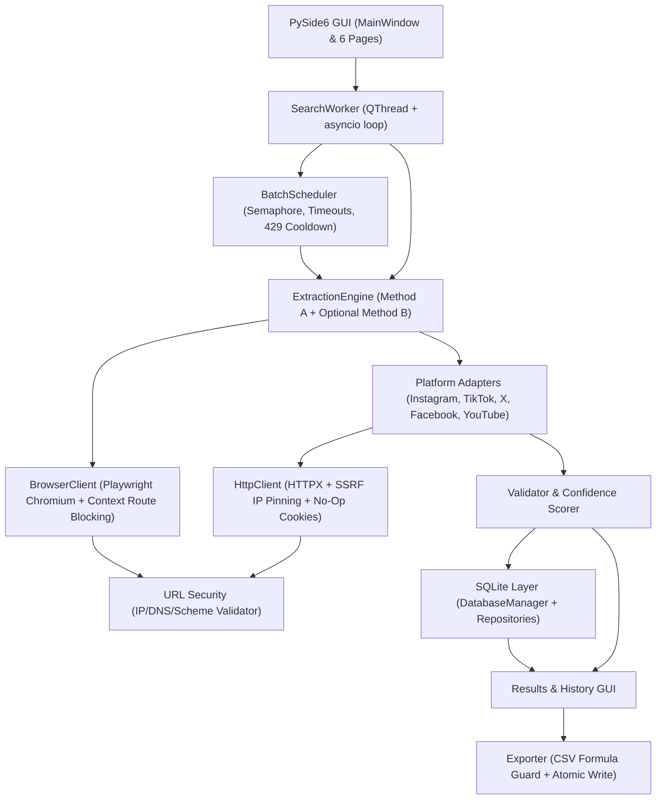

# Social ID Finder

**Security-hardened native Windows desktop application for discovering public social media profile IDs using HTTPX and Playwright Chromium.**


> **Version:** `v1.1.0` — Security-Hardened Release  
> **Official Distribution:** Windows 64-bit **Browser Edition** (`ONEDIR` ZIP and `ONEFILE` executable)

---

## Table of Contents

- [Overview](#overview)
- [Key Features](#key-features)
- [Supported Platforms](#supported-platforms)
- [Official Distribution](#official-distribution)
- [System Requirements](#system-requirements)
- [Installation Guide](#installation-guide)
- [Complete Usage Guide](#complete-usage-guide)
- [Understanding Extraction Results](#understanding-extraction-results)
- [Application Architecture](#application-architecture)
- [Workflow Diagrams](#workflow-diagrams)
- [Security Architecture](#security-architecture)
- [Privacy and Responsible Use](#privacy-and-responsible-use)
- [Local Development](#local-development)
- [Data Storage](#data-storage)
- [Troubleshooting](#troubleshooting)
- [Testing and Verification](#testing-and-verification)
- [Release Downloads](#release-downloads)
- [License and Disclaimer](#license-and-disclaimer)

---

## Overview

**Social ID Finder** is a native Windows desktop application built with **Python**, **PySide6**, **HTTPX**, **BeautifulSoup4/lxml**, **SQLite**, and **Playwright Chromium**. It extracts publicly exposed, platform-specific user or channel identifiers from social media profile URLs without requiring official platform APIs, API keys, user accounts, or browser cookies.

### Username vs. Profile URL vs. Platform Profile ID

- **Username / Handle** (e.g., `@Google`, `instagram`, `X`, `zuck`): A human-readable alias that can often be changed by the account owner.
- **Profile URL** (e.g., `https://www.youtube.com/@Google`, `https://x.com/X`): A public web address pointing to a profile page, which may include mobile subdomains, legacy paths, tabs, or tracking query parameters.
- **Platform-Specific Profile ID** (e.g., YouTube `UC...` Channel ID, X/Instagram/TikTok numeric User ID, Facebook numeric Profile ID): The underlying persistent identifier used internally by the platform.

### Problem Solved & Target Users

Analysts, researchers, digital investigators, threat-intelligence teams, and social media operators frequently need stable platform IDs for OSINT correlation, archival indexing, or cross-checking accounts whose usernames change. Social ID Finder automates public metadata extraction, validates extracted candidates against target identity evidence, classifies confidence honestly, and stores auditable history locally in SQLite.

---

## Key Features

- **Single Profile Lookup:** Fast single-target search supporting URL auto-detection or manual platform selection with live strategy progress updates.
- **Batch Profile Lookup (Up to 10 Entries):** Accepts mixed URLs and usernames, performs offline normalization and canonical deduplication, rejects invalid inputs before network execution, and preserves input order.
- **HTTPX-Based Primary Extraction:** Pooled asynchronous `httpx.AsyncClient` with strict timeouts, `Retry-After` compliance, at most one transient retry, stateless zero-cookie handling, and 10 MB response caps.
- **Playwright Browser Rendering & Fallback:** Bundled headless Chromium (`chromium_headless_shell`) automatically renders JavaScript-heavy public profiles when HTTPX alone receives an unhydrated client-side shell or non-browser rejection.
- **Five Social Media Platform Adapters:** Dedicated extractors for Instagram, TikTok, X (Twitter), Facebook, and YouTube using multi-priority parsing (Embedded JSON → Structured Metadata → HTML Attributes → Identity-Paired Regex).
- **Evidence-Based ID Validation:** Strict per-platform identifier regex and type checks (`NUMERIC_USER_ID`, `NUMERIC_PROFILE_ID`, `CHANNEL_ID`, `SEC_UID`); rejects conflicting IDs, unrelated post/tweet/page IDs, and identity mismatches. Never fabricates IDs.
- **Confidence Classification:** Transparent `HIGH`, `MEDIUM`, `LOW`, and `NOT_VERIFIED` scoring grounded strictly in extraction evidence and identity confirmation.
- **Complete Extraction Metadata:** Records `acquisition_method`, `extraction_method`, `extraction_source`, `response_status`, `final_url`, `validation_status`, `response_time`, and `created_at` for every lookup.
- **Configurable Batch Concurrency:** Bounded async worker pool (`asyncio.Semaphore`, configurable `1–10`, default `3`), separate per-request/per-item/batch timeouts, and per-platform HTTP 429 cooldown tracking.
- **Clean Cancellation & Retry Failed:** Non-blocking `Stop All` / `Stop All Tasks` cancellation preserves completed rows; `Retry Failed` re-runs eligible failed items without overwriting previously `FOUND` entries.
- **SQLite Persistent History & Batch Recovery:** WAL-mode SQLite database (`schema v2`) stores search history, batch sessions, batch items, and settings; interrupted batches are detected on restart for explicit manual resume.
- **Search History & Results Filtering/Sorting:** Filter by platform, status, confidence, or text query; sort by date, platform, confidence, or status; copy individual or selected IDs to clipboard.
- **CSV, JSON, and TXT Export:** UTF-8 exports preserving all 17 canonical fields with CSV formula injection neutralization, export path validation, atomic writes, and credential redaction.
- **Persisted Non-Secret Settings:** Timeouts, concurrency, retry limit, cooldown, sanitized User-Agent, browser fallback toggle, and debug logging persist across restarts.
- **Security Hardening (v1.1.0):** SSRF and DNS rebinding protection across both HTTPX and Playwright, browser context/route/popup isolation, stateless cookie handling, WAL-safe SQLite backups, and expanded log redaction.

---

## Supported Platforms

| Platform | Support | Target Identifier Type(s) | Primary Method & Fallback |
| :--- | :--- | :--- | :--- |
| **Instagram** | Public profile extraction | `NUMERIC_USER_ID` | HTTPX primary → Playwright Chromium fallback (extracts canonical profile-root IDs; excludes 17-digit post Graph FBIDs) |
| **TikTok** | Public profile extraction | `NUMERIC_USER_ID`, `SEC_UID` | HTTPX primary → Playwright Chromium fallback (parses `__UNIVERSAL_DATA_FOR_REHYDRATION__`; `secUid` is never mislabeled as numeric ID) |
| **X / Twitter** | Public profile extraction | `NUMERIC_USER_ID` | HTTPX primary (parses Relay/TanStack SSR `self.$R` / `self.$_TSR` User `rest_id`; strictly excludes Tweet/Post IDs) |
| **Facebook** | Public profile extraction | `NUMERIC_PROFILE_ID` | Sequential: URL ID (`profile.php?id=` / numeric path → `URL_EXTRACTED`) or vanity URL via HTTPX → Playwright Chromium (root-profile `selectedID`/`userID`; excludes posts, comments, photos, and Page IDs) |
| **YouTube** | Public channel extraction | `CHANNEL_ID` (`UC...`, case-sensitive) | HTTPX primary (parses `ytInitialData`, JSON-LD, canonical `<link>`, RSS link) |

### Extraction Reality & Platform Limitations

- Each platform exposes profile metadata differently; HTTPX runs first when applicable, and Playwright Chromium runs only when a supported platform page requires browser rendering.
- **Not every public profile can always be extracted.** Results depend on platform-side login walls, CAPTCHA interstitials, IP/rate limits, regional rules, account privacy settings, and HTML/JSON structure changes.
- Social ID Finder reports platform responses honestly instead of guessing or bypassing restrictions:
  - **`FOUND`**: A valid identifier passed format and identity validation.
  - **`LOGIN_REQUIRED`**: The platform redirected to a login route or returned a login wall (authentication is never bypassed).
  - **`CAPTCHA_REQUIRED`**: The platform presented a CAPTCHA or human-verification challenge (never bypassed).
  - **`RATE_LIMITED`**: HTTP 429 rate limiting or an active per-platform cooldown prevented the request.
  - **`BLOCKED`**: HTTP 403 restriction or an SSRF/security policy block (e.g., redirect to an internal/private address or non-HTTP(S) scheme).
  - **`NOT_FOUND`**: HTTP 404 or no publicly verifiable profile identifier was exposed in the response.

---

## Official Distribution

Only **Browser Edition** is published as an official release distribution. It bundles both the **HTTPX** extraction engine and **Playwright + Chromium headless shell** so all five platforms work out of the box without manual browser installation.

| Official Package | Format | Verified Size | Contents & Startup Behavior |
| :--- | :--- | ---: | :--- |
| **`SocialIDFinder_Browser_ONEDIR.zip`** | Directory archive (`ONEDIR`) | **216.39 MB** ZIP (**505.67 MB** extracted, 706 files; `SocialIDFinder.exe` is 7.36 MB) | Recommended for regular desktop use. Contains `SocialIDFinder.exe` alongside `_internal/` (PySide6, HTTPX, Playwright driver, Chromium headless shell). Launches immediately after extraction. **Do not move `SocialIDFinder.exe` out of its folder.** |
| **`SocialIDFinder_Browser.exe`** | Single executable (`ONEFILE`) | **209.46 MB** | Portable single-file binary with Chromium and dependencies bundled internally. Easier to carry as one file, but startup takes several seconds while PyInstaller unpacks runtime files into a temporary directory. |

---

## System Requirements

Only verified requirements are listed below:

- **Operating System:** Windows 64-bit (developed and verified on **Windows 11 x64**; Windows 10 x64 is targeted by the PySide6/Chromium 64-bit toolchain, though independent testing on a clean Windows VM has not yet been completed).
- **Python:** **Not required** for binary users.
- **Runtime Libraries:** Standard Windows 64-bit system libraries (if a fresh Windows installation lacks `vcruntime140.dll`, install Microsoft Visual C++ Redistributable x64).
- **Network Connectivity:** Active outbound HTTPS access to public social media platforms.
- **Disk Space:**
  - At least **750 MB** free for `ONEDIR` extraction (505.67 MB extracted + temporary space), or **~750 MB** free for `ONEFILE` (209.46 MB binary + temporary runtime extraction on launch).
  - Additional storage under `%APPDATA%\Social ID Finder\` for SQLite database, WAL files, rotating logs, backups, and exports.

---

## Installation Guide

### Option 1: Browser Edition ONEDIR (Recommended)

1. Open [GitHub Releases](https://github.com/aldisaw/socialmedia-idfinder/releases) and select **v1.1.0**.
2. Download `SocialIDFinder_Browser_ONEDIR.zip` and `SHA256SUMS.txt`.
3. Verify the SHA-256 checksum in PowerShell before extracting:
   ```powershell
   Get-FileHash .\SocialIDFinder_Browser_ONEDIR.zip -Algorithm SHA256
   ```
   Compare the output against `SocialIDFinder_Browser_ONEDIR.zip` in `SHA256SUMS.txt`.
4. Extract the complete ZIP archive to a writable or read-only folder (for example, `C:\Tools\SocialIDFinder\`).
5. **Keep `SocialIDFinder.exe` inside the extracted `SocialIDFinder_Browser_ONEDIR\` folder together with `_internal\`.** Moving the `.exe` alone will break dependency resolution.
6. Double-click `SocialIDFinder.exe` to launch.

### Option 2: Browser Edition ONEFILE

1. Open [GitHub Releases](https://github.com/aldisaw/socialmedia-idfinder/releases) and download `SocialIDFinder_Browser.exe` and `SHA256SUMS.txt`.
2. Verify the SHA-256 checksum before running:
   ```powershell
   Get-FileHash .\SocialIDFinder_Browser.exe -Algorithm SHA256
   ```
   Compare the output against `SocialIDFinder_Browser.exe` in `SHA256SUMS.txt`.
3. Double-click `SocialIDFinder_Browser.exe`.
4. Wait several seconds on launch while the single-file package unpacks bundled Chromium runtime files to a temporary directory.

### Windows SmartScreen Notice

The v1.1.0 executables are **not Authenticode code-signed**, so Windows Defender SmartScreen may display an *"Unknown publisher"* warning. **Do not bypass security prompts blindly:** confirm you downloaded the file from `https://github.com/aldisaw/socialmedia-idfinder/releases` and verify that its SHA-256 hash matches `SHA256SUMS.txt` before choosing **More info → Run anyway**.

---

## Complete Usage Guide

All menu names, buttons, and labels below match the actual PySide6 interface.

1. **Launch the Application:** Start `SocialIDFinder.exe` (ONEDIR) or `SocialIDFinder_Browser.exe` (ONEFILE). The main window opens with a left navigation sidebar (`Dashboard`, `Single Search`, `Batch Search`, `Results`, `History`, `Settings`), global controls (`Stop All Tasks`, `Hide Activity Log`, `About`), and the collapsible **Live Activity & Strategy Log** drawer at the bottom (`Clear` clears console text).
2. **Dashboard Overview:** Displays aggregate statistics loaded from SQLite history and **Quick Actions**: `New Single Search`, `Open Batch Search (Max 10)`, and `View Results`, plus a summary of supported platforms.
3. **Open Single Search:** Click **Single Search** in the sidebar (or `New Single Search` on the Dashboard).
4. **Enter a Profile URL or Username:** Paste a full profile URL (leave the platform dropdown on `Auto-detect from URL`) or type a bare username and explicitly select a platform from the dropdown. Watch the `Platform detection:` hint update offline before sending any request.
5. **Run the Search:** Click **Search** (click **Stop** or **Stop All Tasks** at any time to cancel). Live strategy steps appear below the input bar and in the Activity Log.
6. **Review Status & Result:** Inspect the **Latest Result** card showing platform, username, User ID, ID Type, acquisition/extraction metadata, validation status, status badge, and response time. Click **Copy User ID** to copy the verified identifier.
7. **Review Confidence Level:** Check the confidence indicator (`HIGH`, `MEDIUM`, `LOW`, or `NOT_VERIFIED`) alongside `validation_status` before relying on an identifier.
8. **Open Batch Search:** Click **Batch Search** in the sidebar. Paste up to **10** mixed URLs or usernames (one per line). Optionally select a `Default platform for plain usernames:` (default `URL Auto-detect Only`). The counter updates live (`Valid | Invalid | Dup`). Click **Clear Input** to reset the text area.
9. **Configure Concurrency & Timeouts:** Before running a large batch, open **Settings** to adjust `Max concurrent requests (1-10):` (default `3`), `Per-request timeout:`, `Per-item timeout:`, `Batch timeout:`, and `Rate-limit cooldown:`, then click **Save Settings**.
10. **Start & Monitor Batch Progress:** Click **Start Batch** on the Batch Search page. Monitor `Platform:`, `Strategy:`, `Elapsed:`, live status counters, and per-row updates in the batch table.
11. **Cancel a Running Batch:** Click **Stop All** (or **Stop All Tasks** in the sidebar). In-flight requests and Chromium sessions cancel cleanly while completed rows remain preserved.
12. **Retry Failed Items:** After a batch finishes with retryable errors (`ERROR`, `TIMEOUT`, `CANCELLED`, `RATE_LIMITED`), click **Retry Failed**. Previously `FOUND` entries are strictly protected and never overwritten.
13. **Inspect the Results Page:** Click **Results** in the sidebar to view all session results in a sortable, filterable table.
14. **Filter & Sort Results:** Use the text filter, status/confidence filter dropdown, and sort dropdown to narrow results.
15. **Copy IDs:** Click **Copy ID** on any row, or select multiple rows and click **Copy Selected IDs**.
16. **Export CSV:** Choose the export scope (`Filtered`, `Selected`, or `All`) and click **Export CSV**. Choose a `.csv` filename (defaults to `%APPDATA%\Social ID Finder\exports\`).
17. **Export JSON:** Click **Export JSON** to save a UTF-8 JSON array with missing optional fields serialized as `null`.
18. **Export TXT:** Click **Export TXT** to save a structured plain-text audit log containing all 17 canonical fields per entry.
19. **Browse & Manage History:** Click **History** in the sidebar. Filter by `All Platforms`, `All Statuses`, `All Confidence`, text search, and `Date: Newest` / `Date: Oldest`. Use **Refresh**, per-row **Copy ID**, **Export CSV** / **Export JSON** / **Export TXT**, **Delete Selected**, or **Clear History** (requires confirmation).
20. **Batch Recovery After Restart:** If the app closed or crashed mid-batch, Social ID Finder detects unfinished sessions on next startup and marks them `INTERRUPTED` without automatically restarting network traffic. On **Batch Search**, use `Saved Sessions:` → select the session → click **Load**, then click **Resume Batch** to finish pending or retryable items while keeping already `FOUND` rows intact.
21. **Manage Settings:** Open **Settings** to adjust timeouts, `Max concurrent requests (1-10):`, `Transient retry limit (max 1):`, `Rate-limit cooldown:`, `User-Agent:`, `Browser fallback:` (shows live `Browser runtime:` capability), and `Debug mode:`. Click **Save Settings** or **Reset to Defaults**.

---

## Understanding Extraction Results

### Result Statuses

| Status | Meaning |
| :--- | :--- |
| `FOUND` | Valid identifier extracted and passed platform format & validation rules. |
| `NOT_FOUND` | Profile returned HTTP 404 or no publicly verifiable ID was present (or candidates failed identity/conflict checks). |
| `LOGIN_REQUIRED` | Platform redirected to a login route or served a login wall; authentication is never bypassed. |
| `CAPTCHA_REQUIRED` | Platform served a CAPTCHA or anti-bot verification interstitial; never bypassed. |
| `RATE_LIMITED` | Platform returned HTTP 429 or an active per-platform cooldown window skipped the request. |
| `BLOCKED` | HTTP 403 access restriction or URL/SSRF security policy blocked an unsafe destination/redirect. |
| `ERROR` | Unexpected network, HTTP 4xx/5xx, response-size limit, or runtime extraction error. |
| `TIMEOUT` | Per-request, per-item, browser navigation, or overall batch timeout exceeded. |
| `CANCELLED` | Stopped by the user (`Stop` / `Stop All`) or skipped as a concurrent duplicate canonical key. |

### Confidence Levels

| Confidence | Meaning |
| :--- | :--- |
| `HIGH` | Validated identifier extracted from structured page evidence (`EMBEDDED_JSON`, `HTML_JSON_EXTRACTED`, `BROWSER_EXTRACTED`, or `STRUCTURED_METADATA`) with confirmed target identity (`VERIFIED`). |
| `MEDIUM` | Valid identifier from structured page metadata with partial identity confirmation, HTML attribute evidence, or `URL_EXTRACTED` direct URL IDs. |
| `LOW` | Valid identifier from weaker fallback evidence (e.g., regex fallback or TikTok `SEC_UID` without numeric user ID). |
| `NOT_VERIFIED` | No verified identifier produced (`NOT_FOUND`, `LOGIN_REQUIRED`, `CAPTCHA_REQUIRED`, `RATE_LIMITED`, `BLOCKED`, `ERROR`, `TIMEOUT`, `CANCELLED`, or `INVALID_INPUT`). |

### Evidence & Diagnostic Metadata

- **`acquisition_method`**: `HTTP` (Method A via HTTPX), `BROWSER` (Method B via Playwright Chromium), or `NONE` (offline direct URL / invalid input).
- **`extraction_method`**: `EMBEDDED_JSON`, `HTML_JSON_EXTRACTED`, `BROWSER_EXTRACTED`, `STRUCTURED_METADATA`, `HTML_ATTRIBUTES`, `REGEX_FALLBACK`, `URL_EXTRACTED`, or `NONE`.
- **`extraction_source`**: Exact parser path or DOM/JSON field that supplied the candidate (e.g., `ytInitialData`, `browser_dom:html_json:selectedID`).
- **`response_status`**: Final HTTP status code (`200`, `400`, `403`, `404`, `429`, or `0` when no HTTP response occurred).
- **`final_url`**: Final URL after validated redirects.
- **`validation_status`**: `VERIFIED`, `PARTIALLY_VERIFIED`, `UNVERIFIED`, `IDENTITY_MISMATCH`, `CONFLICTING_IDS`, `INVALID_INPUT`, or `NOT_AVAILABLE`.

### `URL_EXTRACTED` vs. Page-Verified Extraction

When a Facebook URL already embeds a numeric identifier (such as `https://www.facebook.com/profile.php?id=100012345678901` or `https://www.facebook.com/100012345678901`), the extractor records it with `extraction_method = URL_EXTRACTED`. Because a URL-supplied ID has not been independently corroborated by live profile page HTML/JSON, the validator strictly caps `URL_EXTRACTED` results at **`MEDIUM` confidence / `PARTIALLY_VERIFIED`** — it is never upgraded to `HIGH` / `VERIFIED`.

---

## Application Architecture

### Actual Repository Structure

```text
.
├── main.py                              # Qt application entry point & logging lifecycle
├── config.py                            # Constants, AppSettings clamping, AppDataLocation paths
├── SocialIDFinder.spec                  # PyInstaller spec (Browser Edition bundles Playwright + Chromium)
├── build_browser_onedir.bat             # Build Browser Edition ONEDIR distribution
├── build_browser_onefile.bat            # Build Browser Edition ONEFILE distribution
├── requirements.txt                     # Core runtime & test dependencies
├── requirements-browser.txt             # Playwright browser dependency
├── pytest.ini                           # Pytest & pytest-asyncio configuration
├── README.md / CHANGELOG.md / RELEASE_NOTES.md / USER_GUIDE.md
├── resources/
│   └── app_icon.ico                     # Multi-resolution Windows desktop icon
├── core/
│   ├── models.py                        # Enums, NormalizedInput, ExtractionCandidate, SearchResult
│   ├── normalizer.py                    # Offline URL parsing, host allowlist, canonical deduplication
│   ├── url_security.py                  # SSRF IP/DNS/scheme/port/credential validator
│   ├── http_client.py                   # Async HTTPX client, manual redirect validation, DNS IP pinning, no-op cookies
│   ├── browser_client.py                # Isolated Playwright Chromium client, context route blocker, max-2 concurrency
│   ├── engine.py                        # ExtractionEngine coordinating Method A (HTTP) and Method B (Browser)
│   ├── validator.py                     # Per-platform ID validation & evidence-based confidence scoring
│   ├── scheduler.py                     # Bounded batch worker pool, timeouts, HTTP 429 cooldown tracker
│   └── logger.py                        # Rotating AppData logger with secret/traceback/CRLF redaction
├── extractors/
│   ├── base.py                          # BaseExtractor 4-priority pipeline & login/CAPTCHA restriction detector
│   ├── instagram.py                     # Instagram public profile adapter
│   ├── tiktok.py                        # TikTok public profile adapter
│   ├── x.py                             # X / Twitter Relay/TanStack SSR adapter
│   ├── facebook.py                      # Facebook sequential URL / HTTPX / Playwright root-profile adapter
│   └── youtube.py                       # YouTube public channel adapter
├── database/
│   ├── database.py                      # SQLite manager (WAL, FKs, schema v1→v2 migrations, Online Backup API)
│   ├── history_repo.py                  # Search history CRUD, filtering, sorting
│   ├── batch_repo.py                    # Batch sessions/items persistence, crash recovery, FOUND protection
│   └── settings_repo.py                 # Non-secret AppSettings persistence
├── exports/
│   └── exporter.py                      # CSV/JSON/TXT exporter (CSV formula neutralization, path check, atomic write)
├── gui/
│   ├── main_window.py                   # MainWindow sidebar, worker coordination, recovery, graceful shutdown
│   ├── worker.py                        # SearchWorker QThread bridging Qt UI and asyncio event loop
│   ├── theme.py                         # Dark-mode Qt stylesheet and platform badges
│   └── pages/
│       ├── dashboard_page.py            # Statistics & quick actions
│       ├── single_search_page.py        # Single profile lookup UI
│       ├── batch_search_page.py         # Batch input, saved sessions, resume, live progress table
│       ├── results_page.py              # Session results filter/sort/copy/export
│       ├── history_page.py              # Persistent SQLite history browser & export
│       └── settings_page.py             # Persisted settings & browser runtime capability display
└── tests/                               # 284 offline unit, integration, packaging, and security tests
```

### Layer Responsibilities

- **GUI Layer (`gui/`, `gui/pages/`)**: Non-blocking PySide6 interface; never runs network I/O on the Qt main thread.
- **Worker (`gui/worker.py`)**: `SearchWorker(QThread)` runs a dedicated `asyncio` event loop with thread-safe cancellation via `loop.call_soon_threadsafe`.
- **Batch Scheduler (`core/scheduler.py`)**: Enforces max 10 entries, `asyncio.Semaphore` concurrency (`1–10`), batch timeout, canonical duplicate guards, and per-platform HTTP 429 cooldowns.
- **Extraction Engine (`core/engine.py`)**: Dispatches normalized targets to platform adapters, enforces per-item timeouts, and triggers optional Playwright fallback only when policy allows.
- **Platform Adapters (`extractors/`)**: Implement 4-priority public parsing and strict exclusion of unrelated IDs (Tweets, Posts, Comments, Photos, Pages, Graph stubs).
- **HTTPX Client (`core/http_client.py`) & Browser Client (`core/browser_client.py`)**: Perform hardened Method A (HTTP) and Method B (Playwright) page acquisition.
- **URL Security (`core/url_security.py`)**: Central SSRF, scheme, port, credential, IP-range, and DNS validation shared by HTTPX and Playwright.
- **Validator (`core/validator.py`) & Models (`core/models.py`)**: Enforce canonical schemas, ID format regexes, identity confirmation, and confidence scoring.
- **SQLite Database & Repository Layer (`database/`)**: Transactional parameterized storage with WAL mode, foreign keys, integrity verification, online backups, and v1 → v2 migrations.
- **Exporter (`exports/exporter.py`)**: Produces sanitized, formula-safe CSV and schema-consistent JSON/TXT files atomically.
- **Logger (`core/logger.py`) & Config (`config.py`)**: AppData path resolution, settings bounds clamping, and sanitized rotating log output.

---

## Workflow Diagrams

### Diagram 1: Extraction Workflow



### Diagram 2: System Architecture



---

## Security Architecture

Version 1.1.0 incorporates the following defensive controls validated by dedicated offline security tests:

- **SSRF Protection & DNS Rebinding Prevention:** Rejects `localhost`, `.local`/`.internal` hosts, loopback (`127.0.0.0/8`, `::1`), RFC1918 private networks, link-local/cloud metadata (`169.254.169.254`, `fe80::/10`), multicast, reserved, unspecified, IPv4-mapped IPv6, and obfuscated numeric/hex/octal IPv4 literals. `_SSRFSafeNetworkBackend` validates DNS resolution at TCP connect time and connects directly to the pinned public IP while preserving native TLS SNI and certificate validation.
- **Manual Hop-by-Hop Redirect Validation:** HTTPX runs with `follow_redirects=False` and validates every redirect target (up to `max_redirects`) against scheme (`http`/`https` only), port (`80`/`443`), credentials, hostname, and DNS/IP rules before sending the next hop.
- **Browser Navigation & Subresource Interception:** Playwright installs a context-wide `context.route("**/*", ...)` interceptor validating initial navigation, 3xx redirects, JS navigations, iframes, `fetch`, `XHR`, and subresources; blocks non-HTTP(S) schemes and private/internal IPs; blocks unnecessary heavy assets (`image`, `media`, `font`); and immediately closes popup pages.
- **Browser Context & Cookie Isolation:** Each Playwright run creates a fresh ephemeral context with no persistent user profile, `accept_downloads=False`, `service_workers="block"`, and `ignore_https_errors=False`. HTTPX uses a stateless `_NoOpCookies` jar so `Set-Cookie` headers are never stored or leaked across concurrent batch requests.
- **Bounded Concurrency & Resource Cleanup:** Browser launches are capped at 2 simultaneous Chromium instances; `finally` cleanup steps are shielded and time-bounded (`asyncio.shield` + timeout) to prevent orphan Chromium processes on cancellation or shutdown; HTTPX and Browser DOM responses are capped at 10 MB.
- **CSV Formula Injection Neutralization:** CSV export prepends `'` to any cell beginning with `=`, `+`, `-`, `@`, tab, CR, or LF (including whitespace-prefixed formulas) while leaving JSON and TXT exports unaltered.
- **Export Path Validation & Atomic Writes:** Rejects null bytes, Windows reserved device names (`CON`, `NUL`, `PRN`, `AUX`, `COM1`–`COM9`, `LPT1`–`LPT9`), directories, symlinks, extension mismatches, and overwriting SQLite database files; writes via temp file + `fsync` + `os.replace`.
- **SQLite Safety & WAL-Consistent Backups:** All SQL statements use parameterized bindings (`?`), foreign keys are enforced, `PRAGMA quick_check` protects corrupted databases without overwriting them, and `create_backup()` uses SQLite's Online Backup API (`Connection.backup`) to capture uncheckpointed WAL frames atomically.
- **Sensitive Log Redaction & Input Hygiene:** Redacts URL embedded credentials (`user:pass@`), `Authorization`/`Proxy-Authorization` headers (`Basic`, `Bearer`, `Digest`, `Token`), session cookies/tokens (`sessionid`, `csrftoken`, `api_key`, `xs`, `c_user`, `datr`), non-string exception objects, and tracebacks, and strips CRLF log-forging characters. Normalizer rejects URL credentials, non-standard ports, IP literals, and YouTube `..` path traversal; `User-Agent` strips control characters and caps length at 512 chars.

> **Security Note:** These controls materially reduce common desktop/network/export attack surfaces, but no client-side hardening can guarantee absolute security against zero-day browser/OS vulnerabilities or hostile network environments.

---

## Privacy and Responsible Use

- Designed strictly to read **publicly accessible** profile identifiers.
- Does **not** require social media usernames/passwords, API keys, or session cookies.
- Does **not** import browser cookies or maintain persistent login sessions.
- Does **not** bypass login walls, CAPTCHA challenges, or platform rate limits, and does **not** perform proxy rotation or stealth anti-bot evasion.
- Users are solely responsible for complying with applicable laws, data protection regulations, and each platform's Terms of Service.

---

## Local Development

Official end-user downloads are published exclusively as **Browser Edition** packages. Developers running or testing from source can use the following workflow on Windows:

```powershell
# 1. Clone the repository
git clone https://github.com/aldisaw/socialmedia-idfinder.git
cd socialmedia-idfinder

# 2. Create and activate a virtual environment (Python 3.12+; tested on Python 3.14.8)
python -m venv .venv

# 3. Install core and browser dependencies
.\.venv\Scripts\pip.exe install -r requirements.txt
.\.venv\Scripts\pip.exe install -r requirements-browser.txt

# 4. Install Playwright Chromium runtime (required for Browser fallback & builds)
.\.venv\Scripts\playwright.exe install chromium

# 5. Launch the desktop application from source
.\.venv\Scripts\python.exe main.py

# 6. Run the full offline regression & security test suite (284 tests)
.\.venv\Scripts\pytest.exe -q

# 7. Run dedicated security hardening tests
.\.venv\Scripts\pytest.exe tests/test_security_hardening.py -q
```

### Building Browser Edition Packages Locally (PyInstaller)

```powershell
# Build Browser Edition ONEDIR (dist_v1.1.0\SocialIDFinder_Browser\)
.\build_browser_onedir.bat

# Build Browser Edition ONEFILE (dist_v1.1.0\SocialIDFinder_Browser.exe)
.\build_browser_onefile.bat
```

---

## Data Storage

All writable runtime data is stored exclusively under the OS user AppData directory (`QStandardPaths.AppDataLocation`):

```text
%APPDATA%\Social ID Finder\
├── social_id_finder.db          # SQLite database (WAL mode, schema v2)
├── social_id_finder.db-wal      # SQLite write-ahead log (when active)
├── social_id_finder.db-shm      # SQLite shared memory index (when active)
├── social_id_finder.db.*.bak    # WAL-consistent online backups (pre-migration / recovery)
├── logs\
│   └── app.log                  # Rotating sanitized diagnostic log (up to 3 backups)
└── exports\                     # Default save directory for CSV, JSON, and TXT exports
```

- **Read-Only Install Directory:** The executable directory is never written to at runtime.
- **Automatic Schema Migration:** Existing v1.0.0 databases upgrade non-destructively from schema `v1` → `v2` (adding `acquisition_method`, `response_status`, and `final_url`) without losing history, settings, or batch sessions.

---

## Troubleshooting

- **Windows SmartScreen Warning:** Verify the file came from the official GitHub Releases page and verify its SHA-256 hash against `SHA256SUMS.txt` before clicking **More info → Run anyway**.
- **Browser / Chromium Unavailable:** Ensure you are running the official **Browser Edition** and, for `ONEDIR`, did not move `SocialIDFinder.exe` away from `_internal\`. From source, run `.\.venv\Scripts\playwright.exe install chromium`.
- **`LOGIN_REQUIRED`:** The profile or platform requires authentication. Social ID Finder does not bypass logins. For Facebook numeric IDs, supply `https://www.facebook.com/profile.php?id=<NUMERIC_ID>`.
- **`CAPTCHA_REQUIRED`:** The platform presented a human verification challenge. Wait before retrying and lower `Max concurrent requests` in **Settings**.
- **`NOT_FOUND`:** Verify the URL/handle exists publicly and is not suspended, private, or a reserved path.
- **`RATE_LIMITED`:** Wait for the cooldown window to finish; reduce `Max concurrent requests` or increase `Rate-limit cooldown` in **Settings**.
- **`BLOCKED`:** Either the platform returned HTTP 403 or SSRF protection blocked an unsafe/internal redirect target or non-HTTP(S) URL.
- **`TIMEOUT`:** Increase `Per-request timeout`, `Per-item timeout`, or `Batch timeout` in **Settings**, or retry on a more stable connection.
- **Export Failure:** Ensure the filename ends with `.csv`, `.json`, or `.txt`, does not target a directory, symlink, database file, or Windows reserved name (`CON`, `NUL`, etc.), and that the destination folder is writable.
- **SQLite Recovery Required:** If a corruption dialog appears, Social ID Finder preserves the original `.db` file untouched. Close the app, back up or move `%APPDATA%\Social ID Finder\social_id_finder.db` (and any `-wal`/`-shm` files), then relaunch to create a fresh database.
- **Application Fails to Launch:** Confirm you are on 64-bit Windows, extracted the full `ONEDIR` archive, have enough disk space for `ONEFILE` unpacking, and have Microsoft Visual C++ Redistributable (x64) installed if `vcruntime140.dll` is missing.

---

## Testing and Verification

Verified facts for **v1.1.0**:

- **Offline Test Suite:** **`284 passed`** (`pytest -q`, 0 failures), covering normalization, all 5 platform extractors, batch concurrency/cancellation/retry, validation/confidence scoring, SQLite v1 → v2 migrations, WAL-safe online backups, and 66 dedicated offline security hardening tests (`tests/test_security_hardening.py`).
- **Browser Edition Read-Only Smoke Tests:** Verified live public extraction across HTTPX and Playwright Chromium with pinned-IP TLS and context route interception (`youtube.com/@Google`, `instagram.com/instagram/`, `facebook.com/zuck`, `x.com/X`, `tiktok.com/@tiktok`).
- **Clean-Folder Isolated Executable Tests:** Four packaged binaries (including internal packaging-validation builds alongside the official Browser Edition ONEDIR and ONEFILE builds; only Browser Edition is published) were copied to isolated `%TEMP%` directories outside the project and launched with `PATH="C:\Windows\System32;C:\Windows"` and zero Python/`.venv`/`PYTHONPATH` references — all launched cleanly (`ALIVE=True`, `EXE_DIR_WRITES=0`, logging and SQLite v2 WAL exclusively under `%APPDATA%\Social ID Finder\`).
- **Checksum Integrity:** All published release assets are verified against `SHA256SUMS.txt` after final ZIP packaging.

### Known Release Limitations

- **Independent Clean Windows VM Pending:** Testing was performed on Windows 11 x64 in isolated clean directories with stripped `PATH`; independent testing on a separate clean Windows VM has not yet been performed.
- **Unsigned Executables:** Release binaries are not Authenticode code-signed and may trigger Windows SmartScreen on first run.

---

## Release Downloads

Official releases are published at:  
**https://github.com/aldisaw/socialmedia-idfinder/releases**

Published assets for **v1.1.0** (Browser Edition only):

- `SocialIDFinder_Browser_ONEDIR.zip` — Full directory distribution (216.39 MB ZIP / 505.67 MB extracted)
- `SocialIDFinder_Browser.exe` — Portable single-file executable (209.46 MB)
- `SHA256SUMS.txt` — SHA-256 verification checksums for all release assets
- `RELEASE_NOTES.md` — Release summary and changelog highlights
- `USER_GUIDE.md` — End-user installation and usage guide

---

## License and Disclaimer

**License:** No `LICENSE` file has been assigned to this repository yet. Until an explicit license is added by the repository owner, all rights remain reserved by default.

**Disclaimer:** Social ID Finder is provided as-is for lawful public metadata research, OSINT analysis, and administrative verification. The authors are not responsible for misuse or violations of third-party Terms of Service or applicable laws.
