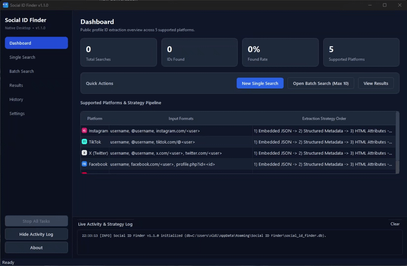

# Social ID Finder

**A powerful Windows desktop tool to find and extract public profile IDs from Instagram, TikTok, Facebook, X (Twitter), and YouTube URLs. Powered by Python, HTTPX, and Playwright Chromium, with automated browser rendering, batch lookup, and evidence-based ID validation.**

<!-- Application Preview: replace with docs/assets/social-id-finder-overview.gif when the animated overview GIF is supplied -->

## About

**Social ID Finder** is a native Windows desktop application that extracts publicly available, platform-specific profile and channel IDs from social media URLs without official APIs or user credentials. It combines fast HTTPX extraction with an integrated Playwright Chromium fallback, evidence-based validation, and local SQLite history for OSINT, research, and account-tracking workflows.

## Features

- **Single profile lookup** with offline URL normalization and platform auto-detection.
- **Batch lookup** for up to 10 mixed URLs or usernames with canonical deduplication.
- **HTTPX + Playwright Chromium extraction** running HTTP first with automatic browser fallback when needed.
- **Five platform adapters** tailored for Instagram, TikTok, X (Twitter), Facebook, and YouTube.
- **Evidence-based ID validation** and confidence scoring (`HIGH`, `MEDIUM`, `LOW`, `NOT_VERIFIED`).
- **Batch concurrency and retry** with bounded workers, timeouts, cancellation, and HTTP 429 cooldowns.
- **SQLite search history** with WAL persistence and manual interrupted-batch recovery.
- **CSV, JSON, and TXT export** with formula-injection neutralization, path validation, and atomic writes.

## Supported Platforms

| Platform | Target ID Type | Acquisition |
| :--- | :--- | :--- |
| **Instagram** | `NUMERIC_USER_ID` | HTTPX → Playwright fallback |
| **TikTok** | `NUMERIC_USER_ID` / `SEC_UID` | HTTPX → Playwright fallback |
| **X (Twitter)** | `NUMERIC_USER_ID` | HTTPX (SSR JSON) |
| **Facebook** | `NUMERIC_PROFILE_ID` | Direct URL / HTTPX → Playwright fallback |
| **YouTube** | `CHANNEL_ID` (`UC...`) | HTTPX |

Extraction results depend on public profile availability and platform restrictions (login walls, CAPTCHAs, rate limits, and markup changes).

## Download

Official Windows 64-bit **Browser Edition** releases (includes PySide6, HTTPX, Playwright driver, and Chromium Headless Shell — no Python required):

| Package | Size | Notes |
| :--- | ---: | :--- |
| **`SocialIDFinder_Browser_ONEDIR.zip`** | 216.39 MB ZIP (505.67 MB extracted) | **Recommended** — faster startup after extracting the full folder. |
| **`SocialIDFinder_Browser.exe`** | 209.46 MB | **Portable ONEFILE** — single executable; unpacks runtime on launch. |

Download from **[GitHub Releases](https://github.com/aldisaw/socialmedia-idfinder/releases)** (includes `SHA256SUMS.txt`).

## Quick Start

1. Download a **Browser Edition** package (`SocialIDFinder_Browser_ONEDIR.zip` or `SocialIDFinder_Browser.exe`) and `SHA256SUMS.txt` from [GitHub Releases](https://github.com/aldisaw/socialmedia-idfinder/releases).
2. Verify the SHA-256 checksum (`Get-FileHash <file> -Algorithm SHA256`), and extract the full ZIP if using ONEDIR.
3. Launch `SocialIDFinder.exe` (or `SocialIDFinder_Browser.exe`), enter a profile URL, and click **Search**.

See [USER_GUIDE.md](USER_GUIDE.md) for full installation, SmartScreen, batch recovery, export, and troubleshooting instructions.

## Documentation

- [USER_GUIDE.md](USER_GUIDE.md) — Installation, complete usage guide, result statuses, confidence scoring, local development, and troubleshooting.
- [RELEASE_NOTES.md](RELEASE_NOTES.md) — v1.1.0 release highlights, security hardening summary, and distribution details.
- [CHANGELOG.md](CHANGELOG.md) — Version history from v1.0.0 to v1.1.0.

## Security & Privacy

- **SSRF and redirect protection** blocking private/loopback/link-local IPs, DNS rebinding, and non-HTTP(S) schemes in both HTTPX and Playwright.
- **No login credentials or session cookies required** — stateless HTTP requests and ephemeral browser contexts.
- **No login or CAPTCHA bypass** — reports `LOGIN_REQUIRED`, `CAPTCHA_REQUIRED`, and `RATE_LIMITED` honestly.
- **Local SQLite storage** under `%APPDATA%\Social ID Finder\` with parameterized queries, WAL-safe backups, and redacted logs.
- **Evidence-based validation** rejecting conflicting, malformed, or unrelated post/page identifiers.

## Testing

- **284 offline tests passed** (unit, integration, SQLite migration, and security hardening suites).
- **Browser Edition smoke tests passed** across public HTTPX and Playwright Chromium lookups.
- **Clean-folder executable tests passed** for Browser ONEDIR and ONEFILE without Python or `.venv`.
- **Pending:** Independent clean Windows VM verification and Authenticode code signing (SmartScreen may prompt on first run).

## License

No `LICENSE` file has been assigned to this repository yet. All rights remain reserved until a license is added.
